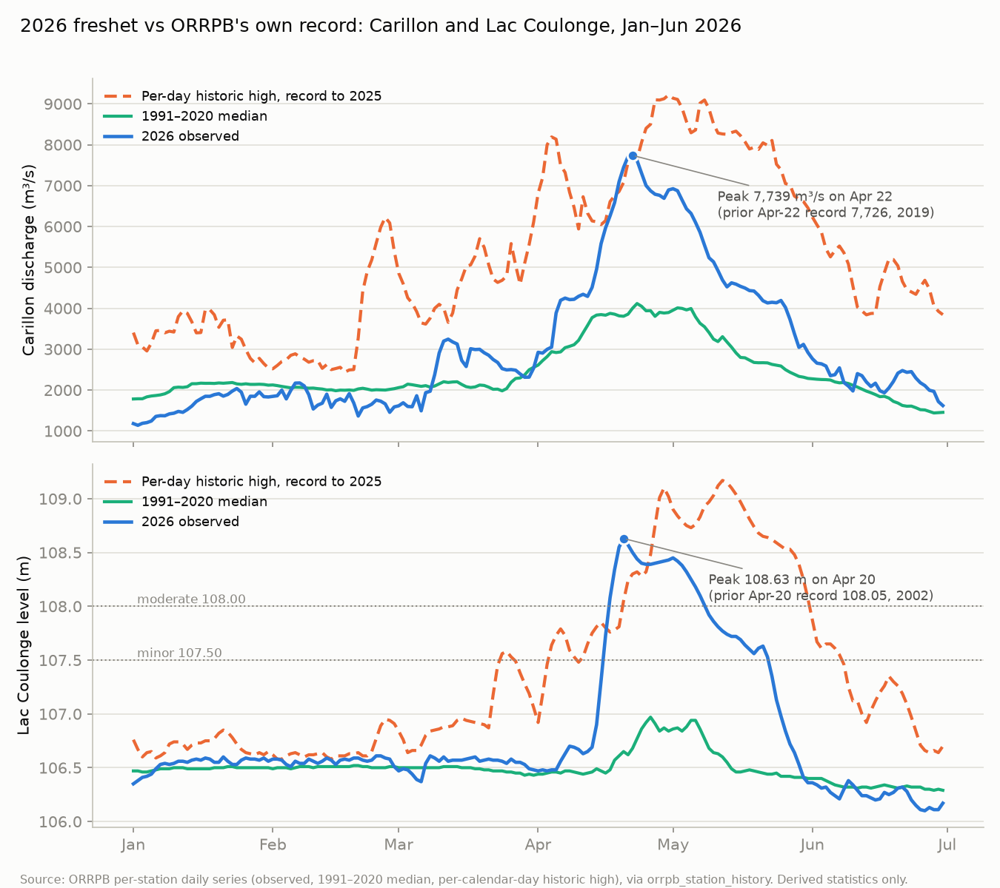

# ORRPB's 2026 Spring Freshet Review, cross-checked: the numbers are right, the story is incomplete

**Compiled 2026-11-03 from ORRPB's "2026 Spring Freshet Review" bulletin (4 pages, posted 2026-11-02, [PDF](https://www.ottawariver.ca/wp-content/uploads/2026/11/Bulletin-2026-Spring-Freshet-Overview.pdf)), checked line by line against the ORRPB daily series mirrored in our data tier. Companion to [Lake Coulonge 2026 vs median](2026-05-26_lake_coulonge_2026.md), [Carillon peaks and volume narrative](2026-05-27_carillon_peaks_volume_narrative.md) and [Storage vs freshet volume](2026-05-27_storage_vs_freshet_volume.md).**

## Plain language summary

ORRPB published its official look-back on the 2026 freshet on November 2. We checked it. In short:

1. **Every number in the review that we can test is correct.** Carillon peak 7,739 m³/s, Britannia 60.22 m, Lac Coulonge 108.63 m, and all four main-stem seasonal averages match our copy of ORRPB's daily series exactly, to the cubic metre per second and the centimetre. Nobody should dispute these figures.
2. **The review describes one peak. There were two.** The lower river (Lac Coulonge, Britannia, Hull, Carillon) crested April 20 to 22. The upper river (Mattawa, Des Joachims, Pembroke, Témiscaming) crested April 29 to May 2. The review says peak levels came "late April through early May", which is only true upstream of Pembroke. For the property reach the peak was a week earlier than the review implies.
3. **It was a record-setting event at nine stations, and the review does not say so.** On its peak day, each of Carillon, Britannia, Lac Coulonge, Hull, Thurso, Chenaux, Des Joachims, Otto Holden, Témiscaming and Mattawa beat the previous highest value ever recorded on that calendar date. Lac Coulonge beat the old April 20 mark (2002) by 58 cm. The review's charts show this, but the captions say only "above normal range".
4. **"Fourth highest on record" at Carillon depends on what "record" means.** Since the Board was created in 1983, yes: 2019, 2017, 2023, then 2026. In ORRPB's own published Carillon summary going back to 1964, 2026 is sixth, behind 1976 (8,190) and 1974 (8,105) as well.
5. **ORRPB did keep communicating through the peak, but only through daily forecasts.** The review lists three communications (March 11, April 2, April 13). The website archive shows a forecast posted every single day from April 13 to May 15, plus a PSPC bulletin on Lake Timiskaming on April 30. What is true is that no press release was issued between April 13 and the April 20 to 22 crest, or at the second crest. Whether a daily forecast counts as "warning the public" is a fair question; saying ORRPB went silent is not.
6. **The reservoir-effect claim (about 5,000 m³/s shaved off a natural peak near 12,700) cannot be checked from public data.** It comes from ORRPB's internal model. We note it, we do not dispute it, and we cannot confirm it.
7. **The storage-volume chart is the one piece of the review we cannot reproduce.** ORRPB publishes it only as a picture, once a year. We found that the per-reservoir history pages on ottawariver.ca serve the same observed / median / historic tables we already ingest for river stations, with the operating limits attached. Extending our ingester to those 14 pages has been filed as OTTAW-28 (see check 7). That gets us the levels behind the chart; converting levels to billions of cubic metres still needs curves ORRPB does not publish.

Fair summary: the review is accurate, defensive, and incomplete. Its physical explanation (60% of the basin has no reservoirs; the freshet was bigger than the storage) is correct and matches what this case file has said since May. What it leaves out is the timing, the records, and any estimate of how much the regulated north contributed to the April 20 to 22 lower-stem crest versus the unregulated central basin. That last number is the one that would settle the drawdown argument, and neither side has it.

## What the review says

- Headline numbers: Carillon peak 7,739 m³/s (stated as fourth highest on record), Britannia peak 60.22 m, Lac Coulonge peak 108.63 m.
- Narrative: early melt in the south in March, cold snap, central basin runoff drove the main stem up in early April, minor flood thresholds exceeded by mid April, rapid melt of a "historically large" northern snowpack plus rain-on-snow from late April gave the peak, major thresholds exceeded, recession through May.
- Reservoir effect: a model chart showing observed Carillon discharge against estimated discharge "without reservoir effects". Claimed reduction close to 5,000 m³/s, from a natural peak near 12,700 m³/s.
- Public communications table: March 11 bulletin, April 2 press release #1, April 13 press release #2.
- Seasonal averages (March 1 to June 15): Timiskaming 1,251, Des Joachims 1,617, Britannia 2,450, Baskatong 318, Carillon 3,974 m³/s, with percentiles and 30-year ranks.
- Two-phase regulation strategy: hold reservoirs low through early April, then strategic refill from mid April.
- A note that summer and fall 2025 were dry, so the reservoirs reached their seasonal low a month early (beginning of March) and held there, meaning storage space was available early. Despite that, major thresholds were "still widely exceeded".
- Storage-volume chart: water stored in the 13 principal reservoirs, 2026 against 2025, the 1991 to 2020 median and the 10th to 90th percentile band.

## Check 1: the numbers

| ORRPB figure | Our data tier | Match |
|---|---|---|
| Carillon peak 7,739 m³/s | 7,739 on 2026-04-22 | exact |
| Britannia peak 60.22 m | 60.22 on 2026-04-21 | exact |
| Lac Coulonge peak 108.63 m | 108.63 on 2026-04-20 | exact |
| Témiscaming mean Mar 1 to Jun 15: 1,251 | 1,251 (107 days) | exact |
| Des Joachims mean 1,617 | 1,617 | exact |
| Britannia mean 2,450 | 2,449 | rounding |
| Carillon mean 3,974 | 3,974 | exact |
| Baskatong mean 318 | not testable, our reservoir outflow series starts May 5 | n/a |
| Storage volume trajectory | not testable, we hold reservoir levels, not volumes | n/a |
| Natural peak near 12,700, reduction near 5,000 | not testable, internal model | n/a |

Conclusion: the review is built from the same published daily series we mirror. Everything we can check agrees.

## Check 2: when the peak actually happened

The review's text places the peak in "late April through early May". ORRPB's own daily series says the river crested twice, a week apart, in two different places.

| Station | Crest 1 (lower stem) | Crest 2 (upper stem) |
|---|---|---|
| Lac Coulonge level | **108.63 m, Apr 20** | 108.45 m, May 1 |
| Britannia level | **60.22 m, Apr 21** | 60.08 m, Apr 29 |
| Hull level | **44.46 m, Apr 21** | 44.09 m, Apr 29 to May 1 |
| Carillon flow | **7,739 m³/s, Apr 22** | 6,924 m³/s, May 1 |
| Pembroke level | 113.09 m, Apr 19 | **113.17 m, Apr 30** |
| Des Joachims flow | | **3,324 m³/s, Apr 30** |
| Otto Holden flow | | **2,870 m³/s, Apr 30** |
| Mattawa level | | **154.82 m, Apr 29** |
| Témiscaming outflow | | **2,741 m³/s, May 2** |

The first crest was the central and southern sub-basins (unregulated) arriving at the lower river. The second crest was the northern snowpack coming through the regulated reservoirs. The review's "peak occurred late April through early May" describes the second crest only. For Lac Coulonge and everything downstream, the high-water mark was April 20 to 22.

Why it matters: the review's own regulation-strategy section says the "strategic refill" started in mid April. The lower-stem crest came about a week after that switch. How much of the April 20 to 22 water was northern (storable) versus central (not storable) is exactly the number that would tell us whether an earlier or deeper refill could have shaved the property's peak. The review does not give it.

## Check 3: record days

ORRPB publishes, for each station and each calendar day, the highest value ever recorded on that date and the year it happened. On the 2026 peak days, these stations beat their calendar-day record:

| Station | 2026 peak | Previous record on that date |
|---|---|---|
| Lac Coulonge level (Apr 20) | 108.63 m | 108.05 m (2002), **+58 cm** |
| Britannia level (Apr 21) | 60.22 m | 60.16 m (1951) |
| Hull level (Apr 21) | 44.46 m | 44.13 m (2019) |
| Thurso level (Apr 22) | 43.06 m | 43.02 m (2019) |
| Carillon flow (Apr 22) | 7,739 m³/s | 7,726 m³/s (2019) |
| Chenaux flow (Apr 21) | 4,061 m³/s | 3,763 m³/s (2002) |
| Des Joachims flow (Apr 30) | 3,324 m³/s | 3,210 m³/s (1979) |
| Otto Holden flow (Apr 30) | 2,870 m³/s | 2,450 m³/s (1979) |
| Témiscaming outflow (May 2) | 2,741 m³/s | 2,578 m³/s (1979) |
| Mattawa level (Apr 29) | 154.82 m | 154.63 m (1979) |

Two honesty notes. First, these are same-date records, not all-time records: 2019 reached 9,217 m³/s at Carillon on April 30 and 2017 reached 9,094, both well above 2026. Second, the review's charts do plot the historic-high line, and the 2026 line visibly crosses it; what is missing is any sentence saying so. "Above normal range" is the caption on all three charts. Lac Coulonge was 58 cm above anything recorded on that date in ORRPB's published record.

Lac Coulonge was above the 107.50 m minor-flood threshold from April 16 to May 22 (37 days) and above the 108.00 m moderate threshold from April 17 to May 8 (22 days).

## Check 4: "fourth highest on record"

ORRPB's own historical summary for Ottawa River at Carillon (annual daily maximum, 1964 onward) ranks the peaks:

| Rank since 1964 | Year | Peak daily flow (m³/s) |
|---|---|---|
| 1 | 2019 | 9,217 |
| 2 | 2017 | 9,094 |
| 3 | 1976 | 8,190 |
| 4 | 1974 | 8,105 |
| 5 | 2023 | 8,015 |
| 6 | **2026** | **7,739** |

Counting only years since the Board was formed in 1983, 2026 is indeed fourth (2019, 2017, 2023, 2026). Counting the full Carillon record it is sixth. Counting the pre-dam estimates from Chats Falls (1951 and 1960, see the [Carillon peaks note](2026-05-27_carillon_peaks_volume_narrative.md)) it is eighth. The review does not define "on record". We think they mean the Board era. That is a legitimate choice, but it should be stated, because "fourth highest ever" is how it will be repeated.

## Check 5: did ORRPB go quiet at the peak?

The review's communications table lists three items. The archive on ottawariver.ca for March 1 to June 30 shows:

- March 6: bulletin, "Early Spring Conditions Overview" (the review dates this March 11; the archive post date is March 6)
- April 2: press release #1 "Rising Ottawa River Water Levels", plus a bulletin announcing the start of hydrologic forecasts
- April 13: press release #2 "Increasing Flood Risks Along the Ottawa River"
- April 13 to May 15: a river conditions forecast posted every day, no gaps
- April 30: PSPC bulletin "Rising Water Levels at Lake Timiskaming"
- May 21: bulletin, end of daily forecasts; weekly forecasts after that

So the record is: no press release at either crest, but a daily forecast every day through both. The review's table under-reports what was published (it leaves out the daily forecasts and the PSPC bulletin). A community member who says "they issued nothing at the peak" is wrong about the forecasts and right about the press releases. Both halves matter.

## Check 6: the reservoir-effect chart

The review says the reservoirs cut the Carillon peak by close to 5,000 m³/s, from an estimated natural peak near 12,700. We cannot test that; it is a model output and ORRPB does not publish the model. Three things we can say from the chart itself:

- From January to mid March the observed line sits roughly 800 to 1,000 m³/s **above** the natural line. That is the winter drawdown: stored water being released ahead of the freshet. It is the mirror image of the storage chart on page 4 and confirms the reservoirs did draw down over winter.
- The natural-flow curve has the same two crests as the observed record, with the second one (around April 30) only partly flattened. The regulated north was still passing more water at the second crest than the first.
- In its 2026 public presentation ORRPB put numbers on the 2019 reservoir effect in centimetres at specific places (Lac Coulonge 120 cm, Britannia 75 cm, Hull 130 cm). The 2026 review gives only the Carillon flow figure, no level reductions. The 2019-style table is what residents can actually use, and it is missing.

## Check 7: the storage chart, and the one dataset we do not have

Page 4 plots total water stored in the 13 principal reservoirs. Our tier has reservoir **levels and outflows** from April 23, 2026 onward (ORRPB 8-day conditions table) but no volumes and nothing before April 23, so we cannot reproduce the chart or independently confirm the "seasonal low reached in early March and held" claim.

What we found while checking: ORRPB's per-reservoir pages (`ottawariver.ca/location/baskatong/`, `/dozois/`, `/timiskaming/`, and so on for all 14 principal-reservoir gauges) accept the same daily-history request as the river station pages and return the same four-row table (observed, 1991 to 2020 median, per-day historic high, per-day historic low), plus a "System Constraints" table with each reservoir's lower and upper operating limit (Baskatong 207.60 to 223.14 m, Dozois 336.80 to 345.95 m, Cabonga 356.16 to 360.88 m, Timiskaming 175.50 to 179.56 m). Our existing station-history ingester parses that table unchanged, so the extension is a configuration change plus a backfill. That has been filed as OTTAW-28.

What that gets us: every principal reservoir's 2026 level trajectory against its median, from January 1, which is the data behind the storage chart. What it does not get us: cubic metres. Converting level to volume needs each reservoir's stage-storage curve, which ORRPB does not publish. A linear fraction-of-operating-range times usable capacity (from the ICOLD 2020 case study, 12.14 BCM total) is a usable proxy for "how full", not a reproduction of the chart. We will label it as such if we build it.

## Figure

*Carillon discharge (top) and Lac Coulonge level (bottom), January 1 to June 30, 2026. Blue is 2026 observed, green is the 1991 to 2020 median, dashed orange is the highest value previously recorded on each calendar day over ORRPB's published record to 2025. Both stations crossed the per-day record line in the third week of April. The second, lower crest around April 30 to May 1 is the northern snowmelt arriving through the regulated reservoirs.*

## What this means for the case file

- ORRPB's figures are reliable and we should quote them as published. Arguing about the numbers would be a mistake.
- The critique is about framing: one peak instead of two, "above normal" instead of "record for the date", "fourth highest" without saying since when, and no estimate of the regulated versus unregulated share of the April 20 to 22 crest.
- The review's own storage narrative (reservoirs at seasonal low by early March, held until the melt) is consistent with the [reservoir drawdown note](2026-05-22_reservoir_drawdown.md) for the headwater reservoirs, and it does not change the [Bryson no-drawdown finding](2026-05-26_bryson_no_drawdown.md), which is about a run-of-river dam that is not one of the 13 principal reservoirs.
- The missing number, how much of the lower-stem crest came from the regulated 40% of the basin, is a reasonable thing to ask the Secretariat for directly.

## Source and methodology

- ORRPB "2026 Spring Freshet Review" bulletin, posted 2026-11-02 (PDF metadata creation time 18:18 UTC), and ORRPB "Flow Management in the Ottawa River Basin, 2026" presentation (February 2026) for the 2019 level-reduction table.
- ORRPB per-station daily series (observed, 1991 to 2020 median, per-calendar-day historic high and low with year tag) for Témiscaming, Otto Holden, Mattawa, Des Joachims, Pembroke, Lac Coulonge, Chenaux, Chats Falls, Britannia, Hull, Thurso, Grenville and Carillon, retrieved via our `orrpb_station_history` ingester. Peaks are the maximum of the daily observed value, January 1 to June 30, 2026.
- Seasonal means are the arithmetic mean of ORRPB daily flow, March 1 to June 15, 2026 inclusive (107 days), from `orrpb_river_flows`.
- Carillon annual peak ranking from ORRPB's published historical summary "Ottawa River at Carillon" (monthly means and annual daily max/min, 1964 to 2025).
- Communications list from the ottawariver.ca archive page, read 2026-11-03.
- ORRPB asserts the underlying data may not be reproduced or redistributed. This note presents derived statistics (peaks, dates, means, ranks, threshold-day counts) and cites ORRPB as the source throughout.

## Related case-file material

- [Lake Coulonge 2026 vs median](2026-05-26_lake_coulonge_2026.md), the April 20 record and the 2019 land-survey line
- [Carillon peaks and volume narrative](2026-05-27_carillon_peaks_volume_narrative.md), the 76-year peak series and the volume-driven versus peakedness-driven split
- [Storage vs freshet volume](2026-05-27_storage_vs_freshet_volume.md), 5.74 BCM upper-basin storage against the freshet
- [Reservoir drawdown](2026-05-22_reservoir_drawdown.md)
- [Bryson no pre-freshet drawdown](2026-05-26_bryson_no_drawdown.md)
